# Player NEXT

Player NEXT ist ein Musik-Player für Android, der Bedienung, Funktionsumfang und
Aufbau von **PlayerPro Music Player** nachbaut – ohne dessen Online-Funktionen,
ohne Werbung und mit dem Ziel, deutlich weniger Akku zu verbrauchen.

**Download:** APK unter [Releases](https://github.com/ShakieVan/Player-NEXT/releases/latest)
(Android 11 oder neuer). Neue Versionen findet die App danach selbst
(Einstellungen → Über → Updates). Optik und
Logo orientieren sich an **Tube NEXT** (dunkle Flächen, Orange/Rot-Akzent,
Neon-Play-Symbol).

> Player NEXT ist ein privates Projekt und steht in keiner Verbindung zu
> PlayerPro oder BlastOn SA. Es enthält keinen Code und keine Grafiken von
> PlayerPro; nachgebaut wurden Struktur und Verhalten.

## Warum?

PlayerPro ist ein guter Player, aber er braucht spürbar Energie und hat
Fehler, die trotz Meldung offen bleiben (z. B. der Tag-Editor). Player NEXT
bildet die gewohnte Bedienung nach und setzt auf einen sparsamen Unterbau:

- **Hardware-Wiedergabe (Audio-Offload):** Solange kein Effekt aktiv ist,
  dekodiert der Audio-Chip; die CPU kann schlafen. Gemessen auf einem
  Galaxy S21 bei ausgeschaltetem Bildschirm: rund ein Siebtel der CPU-Last
  gegenüber normaler Wiedergabe (Details in
  [`docs/technical-notes/energie.md`](docs/technical-notes/energie.md)).
- **Bedarfsgesteuerte Wiedergabe-Schleife** statt Aufwachen alle 10 ms.
- **Kein Polling:** Fortschritt und Mini-Player laufen nur sichtbar und im
  Sekundentakt (≈ 1 Bild/s statt laufendem Neuzeichnen). Widgets und
  Benachrichtigung ändern sich nur bei echten Zustandswechseln; periodische
  Positionsmeldungen an das System sind abgeschaltet.
- **Eigener DSP nur bei Bedarf:** Mit neutralen Einstellungen wird das Audio
  unverändert durchgereicht.
- **Sensoren nur auf Wunsch:** Schüttelsteuerung ist aus und läuft – wenn an –
  nur während der Wiedergabe.

## Funktionen

- **Bibliothek wie PlayerPro:** Suche, Alben, Interpreten (wahlweise nach
  Albuminterpret), Komponisten, Genres, Playlists, Ordner, Titel und Videos;
  jeweils Gitter (3 Größen) oder Liste, Sortierung, Auswahlaktion pro Browser.
- **Navigationsmenü** mit Favoriten und Browsern samt Anzahl; im
  Bearbeitungsmodus Browser ein-/ausblenden, Favoriten sortieren/entfernen.
- **Detailansichten** mit Cover-Kopfbereich und „Alle abspielen | Zufällig |
  Alle zu Warteschlange“.
- **Kontextmenüs und Mehrfachauswahl** (Wiedergeben, Warteschlange, Als
  Nächstes, Zufällig, Playlist, Favoriten, Liedtext, Details, Tag-Editor,
  Suchen, Teilen, Klingelton, Löschen …).
- **Jetzt läuft:** Cover wischen (12 Übergangseffekte), Bewertungsleiste,
  Lautstärke, „Hinzufügen zu | Teilen | Liedtexte“, Warteschlange mit Drag &
  Drop und Wischen zum Entfernen, Halten von ⏪/⏩ zum Spulen, Restzeit,
  Format-Zeile, Gesten für Pause, Hoch- und Querformat.
- **Zufallswiedergabe wie bei PlayerPro:** Die Warteschlange wird sichtbar
  gemischt und beim Ausschalten wiederhergestellt – und anders als dort
  wiederholt sich auch bei zehntausenden Titeln keiner, bevor alle einmal
  liefen (auch im Partymix und in jeder neuen Runde mit „Alle wiederholen“).
  Wahlweise **„Lange nicht Gehörtes zuerst“**: Jeder nächste Titel kommt
  zufällig aus der Hälfte, dem Viertel oder dem Achtel, das am längsten nicht
  lief.
- **Equalizer:** 10 Bänder (±12 dB), Preamp, 27 Presets plus eigene, Hall,
  Bass- und Virtualizer-Drehknopf, Lautstärke.
- **Audio:** Gapless, automatisches und manuelles Crossfading, ReplayGain
  (Titel/Album, Vorverstärkung, Übersteuerungsschutz), Balance, Mono,
  Begrenzer, Tonhöhe, Geschwindigkeit, Pause zwischen Titeln, einstellbarer
  Audiofokus.
- **Statistiken und smarte Playlists:** Bewertungen (auch halbe Sterne),
  Wiedergabe-/Überspringzähler, zuletzt gespielt; Kürzlich hinzugefügt, Am
  besten bewertet, Am häufigsten/seltensten, Kürzlich wiedergegeben, Podcasts
  und ein Editor für eigene Regeln.
- **Tag-Editor** für einzelne Titel und Stapel (Titel, Interpret, Album,
  Albuminterpret, Komponist, Genre, Jahr, Titel-/CD-Nummer, Gruppierung,
  Kommentar, BPM, Liedtext, Cover) – schreibt über die Android-Freigabe, ohne
  breiten Speicherzugriff.
- **Liedtexte** aus dem Tag oder aus `.lrc`-Dateien, direkt bearbeitbar.
- **Benachrichtigung** mit zwei frei belegbaren Zusatztasten (Favorit, Stopp,
  Bewerten, Spulen …), Sperrbildschirm-Steuerung über Android, **Android Auto**,
  **Widgets** 4×1, 2×2, 4×2, 4×4 und Plus 4×2.
- **Einschlaf-Timer** mit Ausblenden oder „Titel zu Ende spielen“,
  **Partymix**, **Headset-Tasten** (Mehrfach- und Langdruck), Start bei
  Kopfhörer/Bluetooth, **Schüttelsteuerung** und Umdrehen zum Pausieren.
- **Widget „Plus 4×2“** im PlayerPro-Aufbau (Position, Titel, Interpret,
  Album, ⏪ ▶ ⏩) mit einstellbarer Transparenz; ein Tipp außerhalb der Tasten
  öffnet den Player.
- **Updates** wie bei Mau-Mau Flip: einmal täglich nachsehen (abschaltbar),
  Download nur auf Wunsch, Prüfung von SHA-256 und Signatur; Testversionen
  über den Schalter „Beta-Kanal“ aus
  [Player-NEXT-Beta](https://github.com/ShakieVan/Player-NEXT-Beta/releases).
  Das ist die einzige Internetnutzung der App.
- **Sichern/Wiederherstellen** von Einstellungen und Musikstatistiken,
  M3U-Import/-Export.

Was bewusst fehlt und warum, steht in
[`docs/playerpro-funktionsabgleich.md`](docs/playerpro-funktionsabgleich.md).

## Screenshots

<p>
  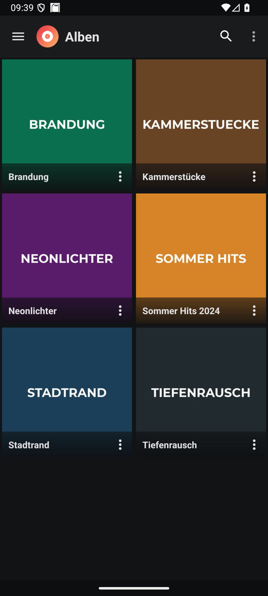
  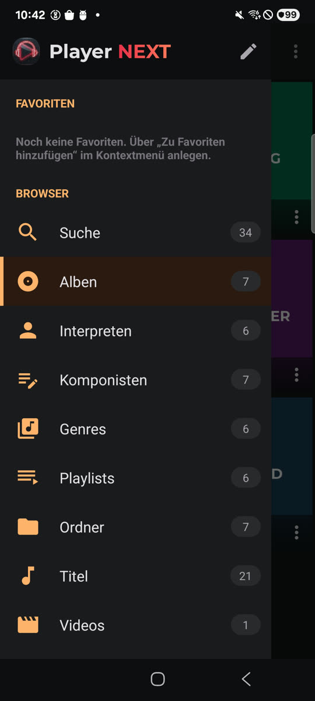
  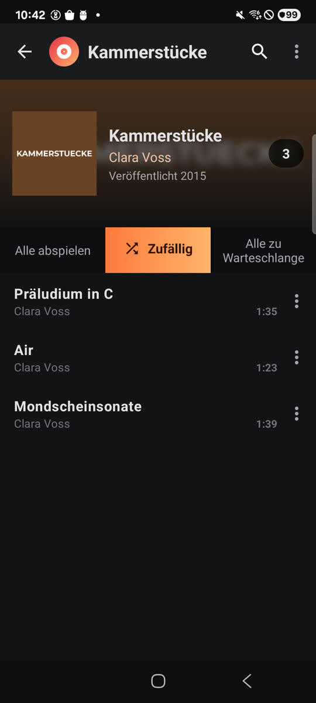
  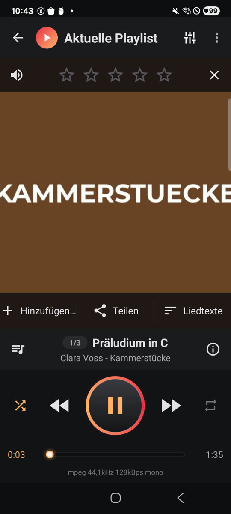
</p>
<p>
  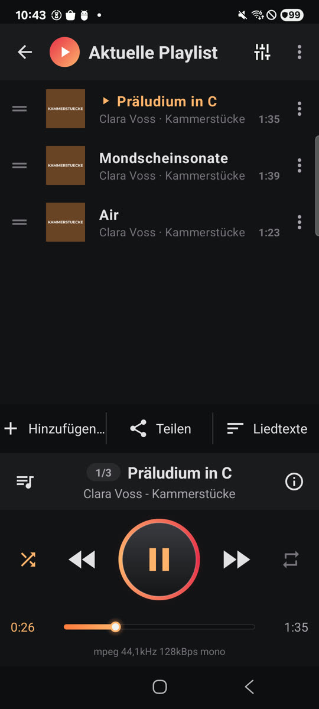
  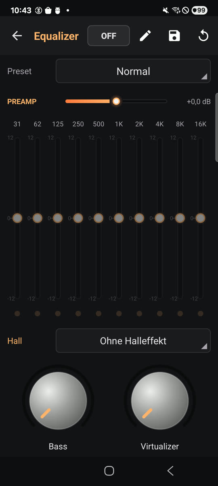
  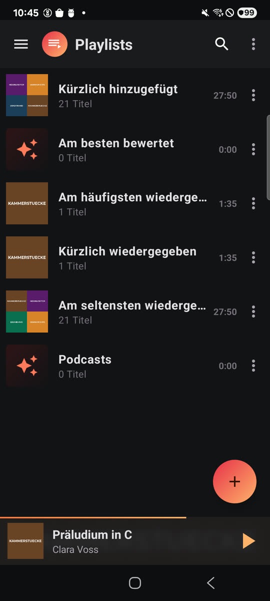
  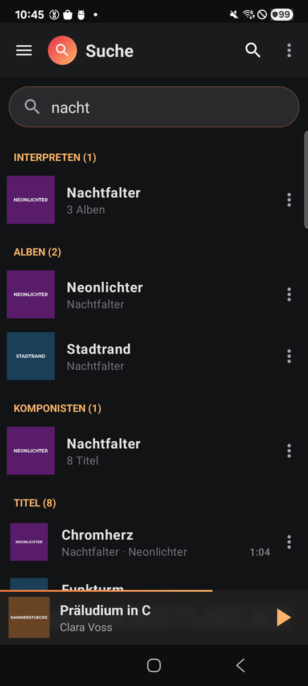
</p>
<p>
  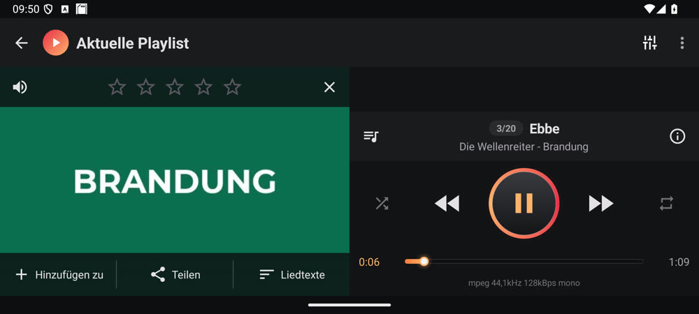
  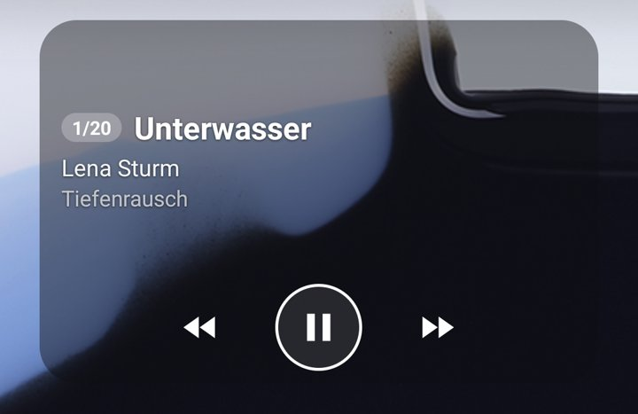
  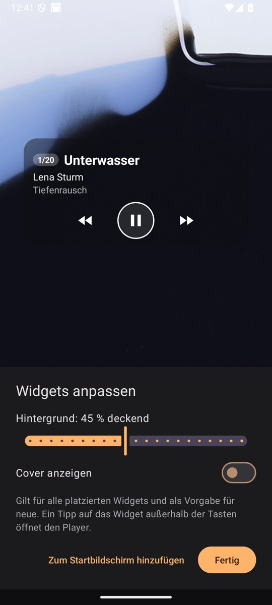
</p>

## Technik

- Kotlin, Android-Views, minSdk 30, targetSdk 35
- AndroidX Media3 (ExoPlayer + MediaLibraryService) für Wiedergabe,
  Benachrichtigung, Sperrbildschirm und Android Auto
- eigener 10-Band-DSP als ExoPlayer-`AudioProcessor`
- jaudiotagger für Tags
- Bibliothek aus MediaStore, Statistiken/Playlists in SQLite

## Bauen

```powershell
.\gradlew.bat :app:assembleDebug --console=plain
```

Debug-Builds haben die App-ID `de.shakie.playernext.debug` und laufen neben
der Release-App. Release (mit R8, ~7 MB):

```powershell
.\gradlew.bat :app:assembleRelease --console=plain
```

Ohne `key.properties` wird der Release-Build mit dem Debug-Schlüssel signiert.
Für eine eigene Signatur `key.properties` mit `storeFile`, `storePassword`,
`keyAlias`, `keyPassword` anlegen (wird nicht versioniert). Updates lassen
sich nur mit demselben Schlüssel über eine installierte Version installieren;
der Ablauf zum Veröffentlichen steht in
[`docs/technical-notes/updates.md`](docs/technical-notes/updates.md).

Tests:

```powershell
.\gradlew.bat :app:testDebugUnitTest --console=plain
```
